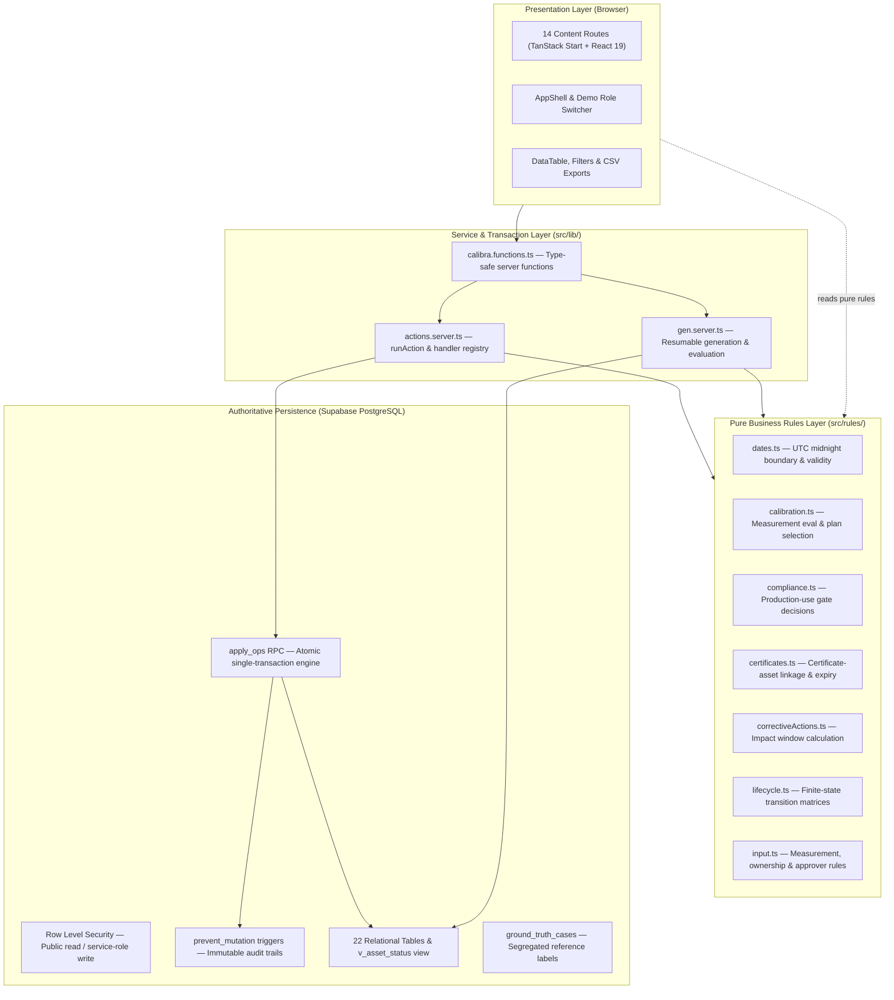

# Calibra — Industrial Calibration Management, Compliance & Traceability

Calibra is an enterprise-grade, database-backed industrial calibration compliance platform built for manufacturing and regulated production environments. It provides end-to-end management for instrument calibration scheduling, measurement validation, digital certificate traceability, work order execution, real-time production-use gating, emergency extension governance, corrective actions (CAPA), failure impact assessments, and tamper-evident append-only auditing.

Calibra features a deterministic synthetic dataset generator, an isolated compliance anomaly detector, and a ground-truth evaluation harness.

---

## ⚡ Quick Start (Run Locally in 3 Steps)

### 1. Prerequisites
- **Node.js** v20+ or v24+
- **npm** v10+ or v11+

### 2. Configure Environment
```bash
# Copy the example environment file
cp .env.example .env
```
Fill in your Supabase project credentials in `.env`:
```env
# Client-side configuration (public)
VITE_SUPABASE_PROJECT_ID="your-project-id"
VITE_SUPABASE_URL="https://your-project-id.supabase.co"
VITE_SUPABASE_PUBLISHABLE_KEY="your-anon-publishable-key"

# Server-side configuration (privileged — never commit to git)
SUPABASE_PROJECT_ID="your-project-id"
SUPABASE_URL="https://your-project-id.supabase.co"
SUPABASE_PUBLISHABLE_KEY="your-anon-publishable-key"
SUPABASE_SERVICE_ROLE_KEY="your-service-role-key"
```

### 3. Initialize Database & Install
```bash
# Apply schema migrations to Supabase (creates all 22 tables, views & triggers)
npx supabase db push

# Install dependencies with legacy peer deps
npm install --legacy-peer-deps

# Start local development server
npm run dev
```
Open **`http://localhost:8080`** in your browser. If starting with a fresh database, visit **Settings** (`/settings`) and click **Generate dataset** with seed `20261022`.

### 4. Run Automated Verification & Tests
```bash
# Run all Vitest unit and business rule test suites (56 tests)
npm run test

# Run TypeScript strict type verification (0 errors)
npx tsc --noEmit
```

---

## 1. System Architecture

Calibra adheres to a strict separation of concerns across five architectural layers:



### Architectural Guarantees
1. **Single Source of Truth for Rules:** Business rules reside strictly in [`src/rules/`](file:///d:/FDE-Assessment/src/rules) as pure, deterministic functions. They are imported by the UI, server handlers, synthetic generator, compliance detector, and unit test suites.
2. **ACID Mutation Engine (`apply_ops`):** The browser performs **only read queries**. Every state mutation executes server-side through `runAction` ([`actions.server.ts`](file:///d:/FDE-Assessment/src/lib/actions.server.ts)) into PostgreSQL's `apply_ops` RPC within a single database transaction. Optimistic locking checks (`expect`) reject concurrent modifications.
3. **Immutable Audit & State Logs:** `audit_records` and `state_history` are protected by database triggers running `prevent_mutation()`, prohibiting `UPDATE` or `DELETE` statements.
4. **Strict Ground-Truth Isolation:** The compliance detector ([`src/rules/validation.ts`](file:///d:/FDE-Assessment/src/rules/validation.ts)) reads **only operational records** and never has access to `ground_truth_cases`. Evaluation compares detector findings against ground truth strictly post-detection.
5. **Deterministic IDs & Checksums:** IDs follow strict formatting patterns. Generation is deterministic and reproducible under fixed seeds (`20261022`). Live-created records use `-L` suffixes or advance counters past existing sequences to guarantee collision avoidance.

---

## 2. Technology Stack

- **Frontend:** React 19, TanStack Start (SSR & server actions), TanStack Router, TanStack React Query, Tailwind CSS v4 design tokens, Radix UI primitives, Lucide React, Recharts, Sonner.
- **Backend / Server Actions:** TanStack Start Server Functions (`createServerFn`), Nitro runtime.
- **Database:** Supabase PostgreSQL 17 (relational schema, `btree_gist` exclusion constraints, RLS, triggers, stored procedures).
- **Tooling & Testing:** Vite, Vitest (jsdom environment), TypeScript (strict mode), ESLint, Prettier.

---

## 3. Discovered Application Pages (14 Content Routes)

| Route | URL | Purpose & Implemented Features |
|---|---|---|
| **Dashboard** | `/` | Operational KPIs, asset eligibility metrics, failure trends, downtime totals, and scheduled calibration backlogs. |
| **Assets** | `/assets` | Instrument asset inventory with filtering by type, location, and lifecycle status; modal asset creation and CSV export. |
| **Asset Detail** | `/assets/:assetId` | Comprehensive asset view with tabs for Calibrations, Certificates, Work Orders, Uses, Alerts, and Audit history. Supports editing, quarantine release, and retirement. |
| **Calibration Planner** | `/calibration` | Calibration lifecycle register; schedule, reschedule, start, pass, and fail events. Failing an event automatically triggers quarantine, CAPA, and impact assessment. |
| **Certificates** | `/certificates` | Digital certificate registry with issue/expiry tracking, asset linkage verification, and status monitoring. |
| **Work Orders** | `/work-orders` | Corrective and preventative work orders; assignment, progress tracking, cancellation reasons, and downtime logging. |
| **Production Use** | `/production-use` | Real-time production gating. Separates recorded completed uses from gate attempts (`use_attempts`). Evaluates eligibility against calibration, certificate, and extension status. |
| **Exceptions & Alerts** | `/alerts` | Non-compliance alert management and emergency extensions. Slide-over drawer provides investigation notes, audit history, and condition-verified resolution. |
| **Corrective Actions** | `/corrective-actions` | CAPA workflow for failed calibrations. Calculates affected production-use windows and requires independent approval before closure. |
| **Suppliers** | `/suppliers` | Calibration vendor qualification, status tracking, and validity windows. |
| **Reports** | `/reports` | Plant-level compliance reports: overdue assets, failure rates, completed calibrations, and downloadable CSV summaries. |
| **Data Quality** | `/data-quality` | System integrity center; executes structural validation, compliance detection, baseline cohort evaluation, and reproducibility verification. |
| **Audit Log** | `/audit` | Immutable audit trail displaying before/after diffs (`audit_records`) and lifecycle transitions (`state_history`). |
| **Settings** | `/settings` | Simulation date management, warning thresholds, policy flags, table-level export engine (CSV, JSON, SQL), and resumable data generator. |

---

## 4. Required Entities & Relational Schema

| Entity | Primary Key Pattern | Key Relationships |
|---|---|---|
| `instrument_types` | `PRS`, `TMP`, `FLW`, ... | 1 : N `calibration_plans`, 1 : N `assets` |
| `suppliers` | `SUP-###` | 0..1 : N `assets`, 0..1 : N `calibration_events` |
| `calibration_plans` | `PLN-<type>-V<n>` | N : 1 `instrument_types`. Non-overlapping effective date ranges enforced by `EXCLUDE USING gist`. |
| `assets` | `AST-######` | 1 : N `calibration_events`, `work_orders`, `production_use`, `exception_records` |
| `calibration_events` | `CAL-<asset>-<year>-######` | N : 1 `assets`, N : 1 `calibration_plans`, 0..1 : 1 `certificates`, 0..1 : 1 `impact_assessments` |
| `certificates` | `CERT-<cal_id>` | 1 : 1 `calibration_events`, N : 1 `assets` (checked by detector for mismatches) |
| `exception_records` | `EXC-######` | N : 1 `assets` (emergency validity extensions) |
| `work_orders` | `WO-<year>-######` | N : 1 `assets`, 0..1 : 1 `calibration_events`, 1 : N `downtime_events` |
| `downtime_events` | `DT-######` | N : 0..1 `work_orders`, N : 1 `assets` |
| `production_use` | `USE-<asset>-<timestamp>[-n]` | N : 1 `assets`, 0..1 `exception_records`, 0..1 `calibration_events` |
| `use_attempts` | `ATT-######` | N : 1 `assets`, 0..1 : 1 resulting `production_use` (gating decisions) |
| `alerts` | `ALR-######[-L]` | 0..1 `assets`. Unique `(issue_type, related_entity_type, related_entity_id)` |
| `corrective_actions` | `CA-######[-L]` | N : 1 `assets`, 0..1 `calibration_events`, 0..1 `alerts` |
| `impact_assessments` | `IA-######[-L]` | 1 : 1 failed `calibration_events`, N : 1 `assets` |
| `audit_records` | `audit_id` (bigserial) | Append-only audit log with old and new JSON snapshots. |
| `state_history` | `id` (bigserial) | Append-only entity lifecycle transitions. |
| `ground_truth_cases` | `GT-######` | 366 pre-labelled reference anomaly cases. Segregated from detector inputs. |

---

## 5. Synthetic Dataset & Anomaly Detection

### Baseline Specifications
- **Scale:** 2,000 assets, 5,000 calibration events, 100,000 production-use records, 1-year timeline (2025-10-28 to 2026-10-28).
- **Seed:** `20261022` using deterministic `mulberry32` PRNG.
- **Current Database Row Counts:**
  - `assets`: 2,000
  - `calibration_events`: 5,003 (5,000 baseline + 3 recorded live workflow tests)
  - `production_use`: 100,000
  - `work_orders`: 5,043 (5,040 baseline + 3 test work orders)
  - `alerts`: 369 (366 baseline + 3 test failure alerts)
  - `ground_truth_cases`: 366 (never mutated)

### Four Mandatory Anomaly Scenarios (20 Cases Each in Baseline)
1. **Due-Date Plan Mismatch (`DUE_DATE_PLAN_MISMATCH`):** Calibration event stored `next_due_date` differs from `calibration_date + interval_days_used`.
2. **Expired Instrument Used Without Exception (`EXPIRED_USE_WITHOUT_EXCEPTION`):** Instrument used past its UTC midnight due-date boundary without an approved emergency extension covering the line and time.
3. **Certificate Wrong Asset (`CERTIFICATE_ASSET_MISMATCH`):** Certificate references an asset ID different from the calibration event's asset ID.
4. **Failed Calibration Missing Impact Assessment (`IMPACT_ASSESSMENT_MISSING`):** Calibration event with `result = 'FAIL'` lacking an impact assessment record.

### Evaluation Metrics (Baseline Cohort)
- **True Positives (TP):** 366
- **False Positives (FP):** 0
- **False Negatives (FN):** 0
- **Precision:** 1.00 (100%)
- **Recall:** 1.00 (100%)
- **F1 Score:** 1.00 (100%)
- *Note on TN:* True Negatives are not reported as a scalar metric without an independently defined negative cohort.

---

## 6. Installation & Local Setup

### Prerequisites
- **Node.js:** v20+ or v24+
- **npm:** v10+ or v11+
- **Active Supabase Project** with migrations applied.

### Step 1: Clone & Configure Environment
```bash
cp .env.example .env
```
Fill in `.env` with your Supabase credentials:
```env
# Client-side configuration (public)
VITE_SUPABASE_PROJECT_ID="your-project-id"
VITE_SUPABASE_URL="https://your-project-id.supabase.co"
VITE_SUPABASE_PUBLISHABLE_KEY="your-anon-publishable-key"

# Server-side configuration (privileged — never commit or expose to browser)
SUPABASE_PROJECT_ID="your-project-id"
SUPABASE_URL="https://your-project-id.supabase.co"
SUPABASE_PUBLISHABLE_KEY="your-anon-publishable-key"
SUPABASE_SERVICE_ROLE_KEY="your-service-role-key"
```

> **Security Note:** `SUPABASE_SERVICE_ROLE_KEY` bypasses PostgreSQL Row Level Security to execute `apply_ops` server-side transactions. It must never be prefixed with `VITE_` or exposed to the client. Obtain it from your Supabase Dashboard: **Project Settings → API → Project API Keys → service_role**.

### Step 2: Install Dependencies
```bash
npm install --legacy-peer-deps
```

### Step 3: Run Database Migrations
If setting up a fresh Supabase instance, apply the migrations in [`supabase/migrations/`](file:///d:/FDE-Assessment/supabase/migrations) to establish all 22 tables, foreign keys, RLS policies, views (`v_asset_status`), and stored procedures (`apply_ops`, `prevent_mutation`):
```bash
npx supabase db push
```
*(Alternatively, execute the SQL files from `supabase/migrations/` in your Supabase SQL Editor).*

### Step 4: Populate Data (Deterministic Generation)
Once the database schema is in place:
1. Start the application (`npm run dev`) and navigate to **`http://localhost:8080/settings`**.
2. Under **Synthetic data generation**, verify the default seed is `20261022` and scale is `Full assessment (2,000 assets, 100k uses)`.
3. Click **Generate dataset**.
4. The generation engine runs resumable server steps with idempotent upserts to construct the identical baseline dataset: **2,000 assets, 5,000 calibration events, 100,000 production-use events, and 366 reference ground-truth anomaly cases**. Because PRNG generation is deterministic (`mulberry32`), the output is guaranteed reproducible.

### Step 5: Start the Development Server
```bash
npm run dev
```
Open **`http://localhost:8080`** in your browser.

---

## 7. Verification & Testing

### Run Automated Unit & Rule Tests
```bash
npm run test
```
Executes Vitest over all 6 test suites covering:
- Date boundaries (`isWithinValidity`, UTC midnight expiry)
- Plan selection and tolerance evaluations
- Production gate decisions (`ALLOWED`, `BLOCKED`, `FLAGGED_FOR_REVIEW`)
- Certificate validity and mismatch checks
- CAPA impact windows and independent approver rules
- Action receipts and replay deduplication
- 100,000-row paginated export completeness

### Run TypeScript Type Check
```bash
npx tsc --noEmit
```

### Run Production Build
```bash
npm run build
```

---

## 8. Security & Demo Role Disclaimer

- **Prototype Demo Roles:** The role switcher in the header (`Plant Operator`, `Maintenance Engineer`, `Quality Engineer`, `Production Planner`, `OT/IT Administrator`) is a **prototype demonstration control**.
- **Server Authorization Check:** [`src/lib/actions.server.ts`](file:///d:/FDE-Assessment/src/lib/actions.server.ts) enforces action-prefix permissions on the server. However, because requests carry the demo identity in the payload without a cryptographically signed JWT, **this setup is intended for assessment demonstration only**.
- **Production Requirement:** Before deploying with confidential data, integrate Supabase Auth JWT verification with a dedicated server-side `user_roles` table.

---

## 9. GitHub Submission Checklist

- [x] Sensitive `.env` files excluded in `.gitignore`.
- [x] `.env.example` template provided with clear documentation.
- [x] All Lovable branding, editor telemetry, and message brokers removed.
- [x] Automated tests passing 100% (56/56 tests).
- [x] TypeScript compilation clean (0 type errors).
- [x] Database migrations documented and present in `supabase/migrations/`.
- [x] Core dataset (2,000 assets, 5,000 calibrations, 100,000 uses) preserved intact.
- [x] Ground-truth reference cases (366) isolated from detector inputs.
- [x] Documentation complete across schema, data dictionary, business rules, and validation summaries.
